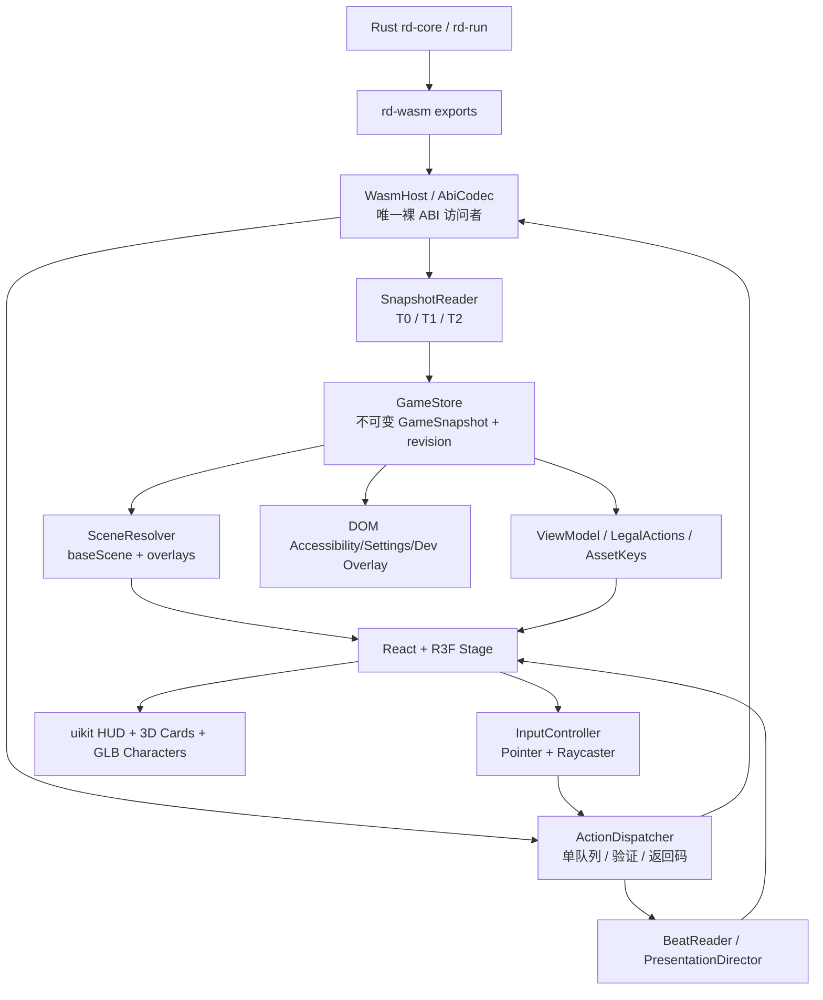
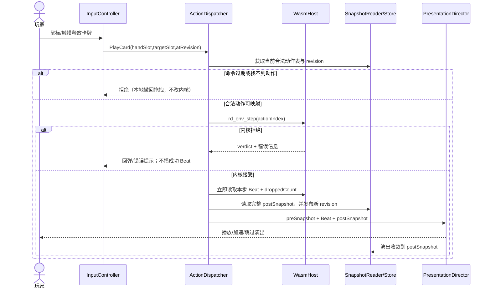
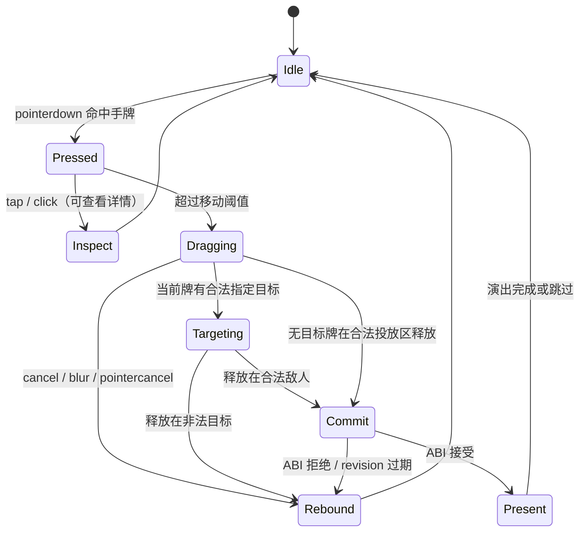

# RogueRust 新一代 Web UI：架构设计与开发实施计划

> **文档性质**：架构提案 + 可执行开发计划（**尚未实现**，不是完成报告）  
> **版本**：Draft v1.1 · 2026-11-11（适配 §349 / commit `29500d47ff7c925da501c718b3568f4313ab2c8e`）  
> **建议存放位置**：`docs/ui-architecture-plan.md`
> **审查基线**：`29500d47ff7c925da501c718b3568f4313ab2c8e`；本文件是实施提案，不是该版本 ABI 的独立运行验证报告。  
> **适用目标**：首期浏览器 WASM；不以 MCU 适配或极限内存预算为验收条件  
> **技术选型**：TypeScript + React + React Three Fiber（R3F）+ Three.js + `@react-three/uikit`；低多边形角色与场景（GLB/GLTF），少量程序化几何与特效；复杂文本与系统表单允许 HTML/SVG 叠层  
> **改动边界**：新建 UI 工程，不重写 Rust Core/Run，不擅自扩展游戏规则，不覆盖原 `web/` 脚手架；只有通过契约测试证明现有 ABI 无法表达真实事实时，才提出最小 ABI 增补。

## 修订说明：v1.1 对 §349 的最小对齐（不改变技术选型）

本版只同步 `29500d4` 已经完成的接口语义清理，**不增加 Rust Core / Run 重构任务，也不要求再新增 WASM 导出**：

1. **场景分层已在旧页面实现**：`web/ui_panels.js` 新增 `resolveScene(s) → { base, overlays, unknownPending }`，仍保留 `classifyScene()` 兼容旧 DOM。新 UI 只需定义类型化适配并验证行为一致，不能重新发明另一套独立场景优先级。
2. **Boss 查询的 A20 时间语义已补齐**：正在战斗返回当前 Boss；两只 Boss 之间且未通关返回空串；第二只 Boss 已击败则可返回最后战斗的 Boss。新 UI 将空串映射为 `null`，**不得以最近一只代替下一只**。
3. **SC-00 事实来源已同步**：是否开局来自 `rd_run_exists()`，不是 `rd_run_seed()` 哨兵；`i32::MIN` 是合法 seed。
4. **显示身份与文字分离已在旧快照落地**：`bossId` 和 `bossName` 同时保留。正式 UI 的 AssetRegistry 一律消费原始 ID；标签仅为展示。
5. **源码与门禁已新增相关测试及负控**（项目自报 23/23 通过）；UI P0 仍要用实际构建的 WASM、真实快照与输入 E2E 复核，不把历史测试记录当作独立证据。

**仍然存在的玩法差异**：Boss 尚未在进入幕时预选，因而战斗开始前不能可靠展示下一只 Boss 的肖像。该项属于 StS 行为保真度任务，不是新 UI 的开工阻塞项。渲染层应显示未知/通用 Boss 入口，不通过额外调用 RNG 偷偷选 Boss。

---

## 0. 执行摘要与裁决

### 0.1 一句话方案

**一套确定性的 WASM 游戏内核 + 一层类型化、可替换的 UI Adapter + 一个统一 R3F 三维舞台 + uikit 空间 HUD + 独立演出调度器。** 游戏事实来自 Snapshot；动作合法性来自内核 Action；Beat 只解释过程与驱动动画。显示名、视觉资源、镜头、动画、交互手势均不进入内核。

### 0.2 为什么不是“全部做成 3D”

- **真正 3D**：战场、英雄和敌人、卡牌实体、光照、空间位置、攻击轨迹、受击与演出。
- **uikit**：战斗内的空间 HUD、血量、状态徽标、意图、手牌文字、商店与奖励卡片等。
- **普通 HTML/SVG**：设置、存档导入/导出、调试日志、长篇规则说明、需要输入法/复制/选中文本和良好可访问性的窗口。它们属于独立 DOM Overlay，不强求塞进 WebGL。
- **可移植的业务语义**：场景解析、动作映射、卡牌展示数据与资源目录不依赖 Three.js，可由未来不同渲染器消费。

**不做**：一开始实现通用 3D 游戏编辑器、基于物理引擎的判定、完整骨骼系统、全内容精细美术、自动生成图灵完备 UI DSL、永久冻结所有既有 WASM 导出。

### 0.3 先后顺序（重要）

1. **契约基线**：确保 `ui-state-model.md` 中已经存在的 ABI、哨兵、场景逻辑与实际代码对上；真实 WASM 快照固化。
2. **低成本 PoC**：以 Mock Snapshot 跑通“3D 卡牌 + 低多边形角色 + uikit HUD + 触摸/鼠标出牌”。
3. **真实 Adapter**：打通 `start → map → fight → reward`；用内核 Action 表，不复制规则。
4. **覆盖全部实际可达场景**，优先功能与交互；随后再做演出、资产、性能优化和最终切换。

阶段验收需要**可独立复现的证据**；不能用提交描述、单测数量或“看起来能玩”替代验证。

---

## 1. 与现有工程契约对接

### 1.1 权威来源及优先级

| 资料 | 用途 | 是否可作为唯一事实 |
|---|---|---|
| `docs/ui-state-model.md` | 场景/层/字段/来源矩阵、T0–T4、Beat 表 | **设计依据**，但有历史叙述和少量旧判据，需先对照实际 ABI |
| `kernel/rd-wasm/src/*.rs` | 真实导出名、参数、返回值、缓冲区、生命周期 | **当前 ABI 实现事实** |
| `docs/spec/env-abi.md` | 冻结约定与历史设计 | 不保证所有字段与最新实现一致；发现冲突需列入核对项 |
| `web/ui_panels.js`、`web/ui_test.mjs` | 已有场景分类、语义测试与回归夹具 | 可借用语义与测试，不拷贝 DOM 结构 |
| `web/index.html` | 旧页面操作流程参考 | 不是新 UI 的架构约束 |
| 本文 | 新 UI 的工程组织、接口层分工、任务与门禁 | **提案**；待 PoC 验证后记录决策 |

**本文核对基线**：固定到 `29500d4` 的 `docs/ui-state-model.md`，文中有 18 条权威场景条目，run 19 格观察、combat 148 格观察、Beat kind 1–13；§349 已同步 Seed、Boss 和复合场景说明。数字仅用于设计基线；正式工程必须由实际 WASM/版本契约验证，不能视为永恒常量。

### 1.2 必须继承的五条原则（对应原文 R1–R5）

1. **单一事实来源**：同一个血量、金币、商店报价等只能由内核状态或既定权威查询提供；ViewModel 可以派生展示格式，但不能引入第二套游戏规则。
2. **哨兵不混淆**：`-1`、`i32::MIN`、零和空串意义不同；进入渲染层前由 Adapter 转为显式联合类型/`null`，不在组件里到处比较数字。
3. **合法动作以内核为准**：卡牌可出性来自合法动作表；商店/事件/篝火使用权威选项与价格，UI 不根据能量、文本或本地规则臆测。
4. **原始槽位保持**：`handSlot`、`enemySlot`、`deckIndex`、商店/事件/奖励 `slot` 均按 ABI 原值传回；过滤展示时不能重排成新索引。
5. **Snapshot 是事实，Beat 是演出**：每个成功动作结束都抓取新事实快照；动画允许播放、跳过、加速或降级，但结束后画面必须收敛到新快照。

### 1.3 建 UI 前先澄清的已知细节（核实清单，而非擅改游戏）

- **SC-00（§349 已同步）**：`rd_run_exists()` 判断是否有 Session；`rd_run_seed()` 只代表 seed 值，不能把 `i32::MIN` 当作空值标志。P0 要验证真实 ABI，而不是再提出相同修复。
- **Boss 身份（§349 已修复已知窗口）**：`rd_run_boss_id_*` 在正在战斗时描述当前 Boss；A20 第一只已击败、第二只未开始且未通关时返回空串；通关后可返回最近击败的 Boss。新 UI 应区分 `active/last` 与尚未选定的 `next` 语义；空串映射为 `null`，不能用池首项或上一只补空。
- **战斗 HP**：战斗中读 `E.obs(4/5)`，非战斗读 `R.obs(2/3)`；`fight_end` 之前运行层 HP 可能未更新。
- **战斗观察**：不能假定有 `rd_env_observe(i)`；优先用已有 `observe_buf()/observe_len()` 或 `observe_into()`，**复制**成 JS 自有快照。
- **场景分层（§349 已有 `resolveScene()`）**：旧版 `classifyScene()` 仍只输出第一命中；新增 `RD_PANELS.resolveScene(s)` 已返回 `{ base, overlays, unknownPending }`。新 UI 对其建立类型化适配与同源语义测试，不要从零实现另一套优先级。
- **SC-02b**：已有文档说明当前内容几乎/完全不可达；不能伪造玩家主路径的通过证据。可保留类型与单独合成夹具。
- **文档漂移（§349 已修关键项）**：SC-00、Boss ID、§5 判定依据已经同步；P0 只审计剩余历史条目和真实导出是否一致，不重复分配已完成的文档修复任务。
- **卡牌实例**：`handSlot` 与 `defSlot` 不等于跨动作稳定的实例身份；新 UI 不得凭 `defSlot` 断言两张同名牌是同一实例。若精确跨区追踪动画真正需要稳定实例 ID，再开单独 ABI 需求。
- **Enemy 角色美术标识**：`enemy_name` 可能是展示文本；渲染器不能把本地化后的名称当资源键。优先使用真实 `enemyId`/内容定义键；当前无可靠 ID 时使用中性占位模型，并记录为候选接口缺口。

### 1.4 冻结哪些，暂不冻结哪些

**本阶段必须稳定**：Action 的含义与返回判定、观察向量字段解释、读写缓冲区约定、场景合法性及 Beat 数值语义（kind 1–13）。

**可以继续演进**：新 UI TypeScript 内部 ViewModel、UI Layout、动画预设、资源键/文件结构、颜色主题、角色模型、部分尚未验证的场景派生类型。既有 ABI 可以通过显式版本/契约测试渐进扩展，**不能默默改哨兵或重排字段**。

---

## 2. 技术栈、工程边界与决策记录

### 2.1 本期选型

| 层 | 方案 | 选择理由 | 原则 |
|---|---|---|---|
| 工程 | Vite + React + TypeScript（严格模式） | 构建、热更、类型/测试工具成熟 | 不要求旧 `web/` 迁移 |
| 三维主舞台 | Three.js + `@react-three/fiber` | 原生 3D、GLTF、深度/光照、Raycaster、统一 Pointer Events | 一个主 Canvas |
| HUD/空间排版 | `@react-three/uikit` | 可在 R3F 内布局容器、文字、SVG、交互控件 | 不承担游戏规则 |
| 常见 3D 工具 | `@react-three/drei` | GLTF 加载、相机、辅助几何、轨迹等 | 只按需引入 |
| 状态 | 轻量不可变快照 + `zustand` vanilla 或 `useSyncExternalStore` | 组件订阅特定字段、避免 WASM 操作分散 | 二选一；PoC 后确定 |
| 动画 | R3F `useFrame` + 简单补间（初期） | 易控、低依赖、可跳过 | 后续再评估 react-spring/three |
| 粒子 | 程序化 Mesh/线条/少量几何（初期） | 保持轻资产、可审计 | 复杂需求出现后再加 three.quarks |
| 角色资源 | Blender → GLB/GLTF（低多边形） | 可在同一 3D 世界真实受光、遮挡和动画 | 原创素材/合规许可 |
| 文字 | uikit MSDF；长文本 HTML | 3D 文字可读，输入/复制适用 DOM | 允许中文字体子集化 |
| 测试 | Vitest + Playwright + Rust 既有验收 | 纯逻辑、真实 WASM、真实触摸/鼠标分层测试 | 每层只证明自己的范围 |

依赖**不在本文写死版本号**：创建工程时从当前发行版选择 React/R3F/Three/uikit 互相兼容的版本并生成 lockfile，记录 `ADR-001`。避免直接照抄旧示例的 Three 版本。

### 2.2 不要提前引入

- Redux 等重型状态框架、XState 全局状态机（当前场景判据已经可从权威快照派生）；如实际复杂度增长再评估。
- 物理引擎（卡牌/敌人“碰撞”只是拾取与演出，不负责游戏规则）。
- 全场景后处理与高复杂度粒子编辑器（首个垂直切片不需要）。
- 另一套独立游戏规则执行器/前端战斗预测器。
- 多 Canvas 的 Rive/Pixi 角色系统（可在后续单独 PoC 比较；首期统一 Three.js）。

### 2.3 待建立 ADR（Architecture Decision Records）

- `ADR-001`：R3F/Three/uikit 版本组合与浏览器目标。
- `ADR-002`：主 Canvas + HTML Overlay 的职责边界。
- `ADR-003`：快照拉取时机、所有权与单线程 ABI 访问。
- `ADR-004`：固定视角与低多边形视觉规范。
- `ADR-005`：动画 Beat 消费与丢失降级策略。

以上 ADR 应当简短，写实测结论，不把未经验证的性能猜测写成事实。

---

## 3. 总体架构与数据流



### 3.1 三条单向通路

1. **事实通路**：`WASM → SnapshotReader → GameStore → ViewProjection → Renderer`。
2. **命令通路**：`Pointer/键盘 → UI Intent → ActionDispatcher → WASM → SnapshotReader`。
3. **演出通路**：`成功 Action → Beat/前后快照 → PresentationDirector → 3D 演出`；演出不写回权威游戏状态。

### 3.2 核心约束

- **`WasmHost` 是唯一能直接访问 `instance.exports` 和 `memory.buffer` 的模块**。业务组件禁止 `ex.rd_run_*`。
- `SnapshotReader` 在成功动作后生成**JS 自有的不可变值对象**；不把 WASM 内存上的 `Int32Array` View 直接放入 React 状态（Memory Grow 后可能失效）。
- 同一时刻仅一个改变游戏状态的 ABI 调用序列在执行；`busy`/`actionEpoch` 防双击、重入和回调重复提交。
- `ActionDispatcher` 对所有操作统一处理：命令类型、参数映射、返回码、错误文案、一次快照更新、Beat 收集。
- UI 的 hover、drag、camera、selectedPreview、modalScroll、animationProgress 是**表现层临时状态**，不能修改内核。
- 角色/卡牌材质变更由受控动画组件拥有；其最终 HP、能量、意图、状态图标必须在动画结束/跳过后与 Snapshot 相同。

### 3.3 一次行动的时序（关键）



**重要**：动作后的 Beat 必须在下一次可能清空日志的动作之前读取；多次出牌不能让上一动作的 Beat 被覆盖。`fight_end` 也要在必要的战斗完成演出之后协调调用。若 Beat 容量溢出，最终状态仍然正确，UI 报告演出不完整并进行 Snapshot 对账降级。

---

## 4. 建议的 TypeScript 契约（只在新 UI 内部）

> 下列类型是 UI Adapter 的**设计模型**，不是宣称现有 WASM 已经导出同名 JSON/结构体。任何字段都必须能追溯到已有 ABI 或明确标为 UI 派生字段。

```ts
// types/game.ts — 只展示核心结构，不强迫第一天填完每个字段
export type EnemySlot = 0 | 1 | 2 | 3 | 4 | 5;
export type HandSlot = number;          // 实际范围由观察/合法动作校验
export type Revision = number;          // UI 本地单调递增，非 WASM 导出

export type GameSnapshot = Readonly<{
  revision: Revision;
  source: { contentFingerprint: string | null; capturedAtAction: number };
  run: RunSnapshot | null;
  combat: CombatSnapshot | null;
  scene: SceneResolution;
}>;

export type RunSnapshot = Readonly<{
  exists: true;
  seed: number;
  act: number;
  floor: number;
  hp: number;
  hpMax: number;
  gold: number;
  pending: number;
  inFight: boolean;
  over: boolean;
  overWhy: number;
  encounterId: string | null;
  bossId: string | null;  // 只能表示 ABI 当时确知的身份，不能预测未知 Boss
  map: readonly MapNode[];
  // rewards / shop / event / campfire / deck / relics / potions 等按场景补齐
}>;

export type CombatSnapshot = Readonly<{
  round: number;
  turn: number;
  phase: number;
  result: number;
  hero: CombatantView;
  enemies: readonly (CombatantView | null)[]; // 以墙位索引，死亡不改变编号
  hand: readonly HandCardView[];
  legalActions: readonly LegalCombatAction[];
  choice: PendingCombatChoice | null;
}>;

export type HandCardView = Readonly<{
  handSlot: number;       // 传入 Action 的参数；不可用数组渲染下标替换
  defSlot: number;        // 内容行号：资源索引可用，跨内容版本不保证稳定
  definitionId?: string;  // 仅在有可信来源时填充
  title: string;
  text: string;
  kind: number;
  cost: number | 'X' | null;
  playableTargets: readonly (number | null)[]; // 从合法动作表派生
}>;

export type LegalCombatAction = Readonly<{
  actionIndex: number; // 仅本 revision 有效
  kind: number;
  handSlot?: number;
  enemySlot?: number; // -1 解码为 undefined/null，而非 0
}>;

export type SceneResolution = Readonly<{
  baseScene: BaseSceneId | 'SC-??';
  overlays: readonly OverlayId[];
  diagnostic?: string;
}>;
```

**建议不要将所有 RunSnapshot 字段一次做成一个超大类型。** 以 `RunSummary`、`MapState`、`ShopState`、`EventState` 等业务切片组织，统一封装在一次 `capture()` 返回值中；当前场景所需数据才读详细文本/列表，但所有本次 UI 展示的事实应属于**同一动作版本**。

### 4.1 类型与数据约定

| 边界 | 约定 |
|---|---|
| `i32::MIN` | 在 Adapter 识别“无局/无效”，**不要**拿 `seed` 值判定有没有局；使用 `rd_run_exists` |
| `-1` | 按各 ABI 的具体含义映射 `null`/`None`/`Unavailable`；不要全局强行同义化 |
| `-2` 等 | 由每个接口签名规定；例如战斗 X 费的 `-2` 是有效值，不是错误 |
| 字符串 | `_len` 是 UTF-8 **字节数**；不以 NUL 结尾；先校验容量与错误码，再解码 |
| 容器位置 | 展示过滤不改原生 `slot`；`deckIndex` 与 `handSlot` 分开建类型/函数 |
| 内容 ID | 用于 AssetRegistry/本地化/测试；人类可读名不作键 |
| `actionIndex` | 只对当前合法动作表有效；异步动画后必须重新匹配新列表 |
| Battle `enemyCount` | 槽位数，死亡槽保留；不要用 count 缩短敌人数组并使编号位移 |
| `ward` 与预留观察格 | 按当前真实 ABI 解释；恒 `-1`/保留字段不渲染，也不当作 0 |
| 过期状态 | 在 ActionDispatch 前核对 `atRevision`；过期命令直接拒绝/要求重新选择 |

### 4.2 `WasmHost` API 设计

```ts
interface WasmHost {
  load(url: string): Promise<void>;
  assertContract(): void;  // 已知必须导出、基本形状/向量长度/内容指纹
  capture(): GameSnapshot; // 复制所有必需数据，不返回内存别名
  dispatch(cmd: GameCommand): DispatchResult;
  getDiagnostics(): RuntimeDiagnostics;
}

type DispatchResult =
  | { ok: true; before: GameSnapshot; after: GameSnapshot;
      beats: readonly GameBeat[]; droppedBeats: number }
  | { ok: false; reason: string; code?: number; stateUnchanged: boolean };
```

**实现细节**：

1. 通过 `WebAssembly.instantiateStreaming` 加载，并支持服务器 MIME 错误时的 `fetch + instantiate` 备用路径。
2. **单点**处理所有 `_len/_into`，先读有效字节数、校验上限和错误码，再使用合适容量的 WASM 可写内存；禁止依赖固定 1KiB scratch 足够所有字符串。
3. 所有读取视图必须随 `memory.buffer` 变化重新创建；发布给 React 的数组一律 `slice()`/拷贝。
4. 原始 ABI 是同步的；初期**不引入 Worker/SAB**。如果未来放入 Worker，必须先定义命令序号、快照提交、日志转发与资源加载错误契约。
5. `contentFingerprint` 用于判断当前资产包/显示名目录是否适配内容版本。指纹不同应明确告警与降级资源，不静默错配 `defSlot`。
6. 读/写调用发生在统一事务内；不在 React render 函数里读取 WASM。

### 4.3 合法动作到 UI Intent 的映射

```ts
type GameCommand =
  | { type: 'startRun'; seed: number; ascension: number }
  | { type: 'moveToNode'; nodeIndex: number; atRevision: number }
  | { type: 'beginNode'; atRevision: number }
  | { type: 'beginFight'; atRevision: number }
  | { type: 'playCard'; handSlot: number; targetEnemySlot: number | null; atRevision: number }
  | { type: 'endTurn'; atRevision: number }
  | { type: 'chooseEventOption'; slot: number; atRevision: number }
  | { type: 'buyShopOffer'; category: 'card'|'colorless'|'potion'|'relic'; slot: number; atRevision: number }
  | { type: 'selectDeckCard'; context: 'smith'|'toke'|'event'|'blessing'|'pickup'|'remove'; deckIndex: number; atRevision: number }
  // 其他既有 Run 动作以后按对应类型增补，禁止统一传动态函数名
```

`playCard` 的 `actionIndex` **在派发时**由当前 `legalActions` 查 `(handSlot, targetEnemySlot)` 得到；不要把旧 `actionIndex` 延迟数百毫秒后直接执行。合法动作表缺少匹配时拒绝；不要自己推断“能量够所以可以出”。

---

## 5. 场景模型与渲染层级

### 5.1 场景双层结构：§349 已实现核心判据，正式 UI 只负责类型化适配

**当前可核实的旧页面接口**：`RD_PANELS.resolveScene(s)` 已存在，返回：

```ts
// 现有 JS 语义（不是 Rust/WASM ABI）
type LegacySceneResolution = {
  base: string;             // 例如 "SC-04"，未知时 "SC-??"
  overlays: string[];       // 例如 ["SC-11a"]，按原判据优先级
  unknownPending: number | null;
};
```

正式 UI 内部可以正规化为：

```ts
type SceneResolution = {
  baseScene: SceneId;
  overlays: OverlayId[];
  unknownPending: number | null;
};
```

注意 **`base` → `baseScene` 是 Adapter 的字段映射，不是要求旧函数改名或新加 WASM 导出**。`SC-11a/11b` 是叠在奖励、宝箱等基础场景上的覆盖层；`SC-14` 的牌组/详情是 UI-only modal，不属于上述权威覆盖层。

**复用方式**：先抽出/镜像 `web/ui_panels.js` 中无 DOM 依赖的 `RAW/SCENES` 判据及 `resolveScene` 语义，通过相同夹具做 parity test。不要将整份旧 DOM 渲染模块直接引进 `web-next/`，也不要在新 UI 另写一套不受对照测试约束的 Pending 优先级。是否提取为双端共享纯模块，应由 PoC 证明收益后单独授权，避免顺手修改旧页面契约。

**必须验证**：奖励 `SC-04` + 遗物欠账 `SC-11a` 同时出现时 `baseScene === "SC-04"` 且 `overlays.includes("SC-11a")`；`pending=99` 且不满足其他合法场景时返回 `SC-??` 并带回原始 `unknownPending`。

### 5.2 18 个场景条目的工程映射

| 现有 ID | 新组件/处理 | 建设批次 | 注意 |
|---|---|---|---|
| SC-00 未开局 | `TitleScene` | P2 | `rd_run_exists()`，seed 可为任意合法 i32 |
| SC-01 祝福 | `BlessingScene` | P4 | offer 数来自 ABI，效果码文字不写死数量 |
| SC-01b 祝福选牌 | `DeckSelectOverlay` | P4 | 强制待决，不可随意关闭 |
| SC-02 地图 | `MapScene` | P3 | Boss 哨兵 `100` 不当成普通地图数组下标 |
| SC-02b 幕尽头 | `EndActScene` | P5 | 当前真实内容不可达/少见：合成夹具单测，不假装真实流程覆盖 |
| SC-03 战斗待开始 | `PreCombatScene` | P3 | `inFight=0` + 节点/事件类型联合判定 |
| SC-03b 战斗中 | `CombatScene` | P2–P3 | 主垂直切片，使用 combat Snapshot |
| SC-04 奖励 | `RewardScene` | P3 | 已拿走项清空但保留槽号 |
| SC-05 商店 | `ShopScene` | P4 | 四类货架、显示实付价、删除服务状态由内核提供 |
| SC-06 篝火 | `CampfireScene` | P4 | 位掩码决定选项，恢复值走 ABI |
| SC-07 宝箱 | `TreasureScene` | P4 | 打开后可能转奖励与遗物欠账 |
| SC-08 事件 | `EventScene` | P4 | 条件 option 的原始 slot 保留；效果列表显示 |
| SC-09 事件选牌 | `DeckSelectOverlay` | P4 | 与事件回路关联，不复制 UI 规则 |
| SC-10 事件候选 | `OfferSelectionScene` | P4 | 可用候选数量来自接口 |
| SC-11a 遗物改牌 | `PickupChangeOverlay` | P4 | 与底层奖励/宝箱可以同时存在 |
| SC-11b 遗物加牌 | `PickupAddOverlay` | P4 | Singing Bowl 特殊选项依据权威字段 |
| SC-12a 幕通过 | `ActClearScene` | P5 | 不与局终状态混淆 |
| SC-12b 局终 | `RunEndScene` | P5 | `over/overWhy` 由内核判定 |
| SC-14 查看牌组等 | `InspectorOverlay` | P4 | **不计入以上 18 条权威场景**，仅是 UI 本地覆盖层 |
| SC-?? 未知 | `UnsupportedStateScene` | P1 | 遇到未知 Pending/组合明确显示诊断，不能退回地图 |

> 批次 P1–P5 是本计划的里程碑代号，不是 Bug 的 P0/P1 优先级。

### 5.3 层级与输入优先级

建议使用**一个** `<Canvas>`，其空间关系分为：

1. `WorldLayer`：战场地台、地面、低多边形背景/道具。
2. `ActorLayer`：英雄、敌人、召唤物；使用可命中的 Collider，而非依赖精细模型表面。
3. `CombatVfxLayer`：轨迹、受击、护盾、粒子、世界空间飘字。
4. `WorldHudLayer`：靠近角色的 HP/格挡/意图/状态，由 uikit 组件或 SDF 文字承担。
5. `CardLayer`：3D 卡牌/手牌；它与世界共用坐标，但有明确的射线命中优先级与拖动抬升层。
6. `ScreenHudLayer`：`<Fullscreen>` 顶栏、回合信息、快捷按钮、菜单入口。
7. `ModalLayer`：必须拦截其后的游戏输入；可用 uikit 大面板或 DOM Portal。
8. `DomOverlay`：设置/输入/可访问性辅助/存档/调试，不放在同一套 3D 深度排序中。

每个世界节点/卡牌节点只允许一个布局或动画控制器持有 transform 写权限。避免多个 `useFrame` 对同一个 `position/rotation` 写入，重演旧版“一个元素两个写者”的问题。

### 5.4 摄像机、坐标与自适应

- **初期固定视角**：优先 OrthographicCamera（稳健复刻 StS 的屏幕布局），场景仍使用真实 3D 网格、深度与光照；如果 PoC 显示透视更有表现力，可切 PerspectiveCamera，但不开放自由视角。
- 定义单位：战场地台宽度为 `WORLD_WIDTH`，Y 轴向上，Z 轴朝向观众；角色站位 `heroAnchor`, `enemyAnchor[0..5]`；手牌在 `handAnchor` 局部坐标。
- 三维世界坐标和屏幕像素/字体布局之间仅由 `CameraLayout` 统一映射，组件不能直接假设一个 CSS 像素等于一个 world unit。
- 桌面横屏布局优先；移动端采用更窄的手牌扇形、可滚动的卡牌详情、始终可见的关键按钮。支持安全区域（`env(safe-area-inset-*)`）。
- 不让相机旋转和拖卡手势竞争：正常对战关闭 OrbitControls，开发调试时可单独打开并明确禁用战斗点击。

---

## 6. 3D 卡牌系统与 Pointer 交互

### 6.1 卡牌渲染方式

每张卡由少量共享几何/材质构成：圆角底板 Mesh + 细边框/类别装饰 + 费用徽标 + uikit/SDF 标题/规则文字 + 可选低多边形徽记。**不生成“每张卡一张大贴图”**。

- 对少量复杂图标可使用 SVG，初期可由 uikit `Svg` 或共享几何路径加载；不要求所有 SVG 都先三角化。
- 卡背、牌面阴影与边缘厚度用几何/材质实现，降低资源传输体积。
- 大量同构卡牌实例共享 geometry/material，单卡实例只改颜色、内容及 transform。
- uikit 文本基于 MSDF；中文/多语言尽量使用预生成字形图集或字体子集，避免浏览器运行时重复生成过大字符集。
- **同名手牌不合并**：每张卡牌用当时的 `handSlot`、`revision` 生成稳定于该快照的 UI Key；跨动作动画不能假装拥有未暴露的持久实例 ID。

### 6.2 手牌布局

`HandLayout` 是纯函数：

```ts
function layoutHand(count: number, viewport: ViewportMetrics): readonly CardPose[];
// 卡片 pose = local position + rotation + scale + z-order
```

初期支持 0–10 张、扇形牌组、hover/选中抬升、拖动时临时 z-order、攻击目标高亮、非法释放回弹。正常画面保留手牌可读区域，不为了立体感让指针命中区域严重重叠。

### 6.3 Pointer 状态机



**交互机制**：

- 使用 Pointer Events 统一鼠标、触屏、触控笔；正常拖卡区域设置合适的 `touch-action`，必要时使用 Pointer Capture。
- 触摸没有 hover：短按预览/长按详情是可选设计；手指拖动期间自动抬升卡牌，避免文字被手遮挡。
- Raycast 目标使用放大的透明 Collider，**视觉模型本身不负责战斗命中规则**。
- R3F 事件可穿透到更远物体，交互对象必须有清晰的 `stopPropagation()`/层级优先级策略，避免点牌时同时点到敌人/场景。
- 显示高亮目标来自 `legalActions`，不根据敌人 `alive`、费用或卡牌描述自行生成另一套规则。
- 结束回合按钮、商店选项、事件选项均可直接点击；不要强迫所有动作都做拖拽。
- `pointercancel`、窗口失焦、Esc、模态打开、场景切换、WebGL context lost 必须能够收起拖动并恢复到确定状态。

**最低可测反例**：两张同名卡费用不同；多个同名敌人；敌人已死亡但槽位未被移除；拖动过程中动作快照被另一事件刷新；手指离开屏幕后释放；modal 打开时无法拖动背后卡牌。

---

## 7. 低多边形角色、敌人与战斗演出

### 7.1 角色资源策略

首期目标不是复制原版 StS 美术，而是建立**轻资产、可批量扩展**的制作管线：

1. Blender 制作低多边形英雄、史莱姆、普通敌人和简单战场道具。
2. 尽量使用顶点色/共享调色板和少量材质；有必要才使用纹理（例如细节标志），避免超大整图。
3. 导出 GLB/GLTF；包括 `Idle`、`Anticipate`、`Attack`、`Hit`、`Down` 等**少量**动作（不是每个敌人都必须具备全部）。
4. 由 `CharacterRig` 将 GLB clips/动画参数转换为统一的表现命令；缺少 clip 时走通用位移/旋转/闪光预设。
5. `AssetRegistry` 管理 `entityId → modelUrl / scale / anchor / clips / palette`；加载失败回退通用占位模型，不因为美术资产缺失影响游戏运行。

**版权**：开源运行库的许可与模型素材许可分开审查；不把原版 StS 角色图、敌人美术直接当成可自由再发布的资产。

### 7.2 模型与实例的 ID

- `actorSlot` 用于一次战斗的游戏操作/站位（`-1` 玩家，`0..5` 敌人）。
- `entityId` 用于挑选模型；必须来自可信的内容 ID/权威查询，不得从中文名字反向推导。
- `presentationInstanceKey` 只用于当前显示对象生命周期，包含 encounter epoch 和 slot；若同一 slot 被删除/新召唤重用，必须创建新表现实例。
- Beat 的 `Summoned/Destroyed` 字段在现有文档中涉及 **ordinal** 语义；不要假设该数字永远等于 enemySlot。先通过真实召唤测试建立映射规则，无法正确映射时按 Snapshot 恢复最终站位并提示演出降级。

### 7.3 演出管线

```text
Action Accepted
    ↓
BeatReader (1..13，顺序不变，含 flags/def)
    ↓
PresentationDirector
    ├─ CharacterAnimation (攻击、受击、死亡)
    ├─ SpatialVFX (刀光、格挡、状态粒子)
    ├─ FloatingText (数值、状态)
    ├─ SfxPlayer (可选)
    └─ CameraMotion (少量震动/推近)
    ↓
Reconcile(postSnapshot)
```

### 7.4 13 种 Beat 的最小消费表

| kind | 必须能表现的最低效果 | 回退行为 |
|---:|---|---|
| 1 Damage | 目标闪烁/掉血飘字/格挡吸收 | 只刷新血条与日志 |
| 2 Block | 护盾数字/短暂辉光 | 直接显示新格挡 |
| 3 Heal | 绿色飘字/缓动血条 | 直接显示新 HP |
| 4 StatusChanged | 状态 chip 新增/层数改变 | 只更新状态列表 |
| 5 StatusRemoved | 状态消散 | 移除 chip |
| 6 StatusPrevented | 抵抗/格挡状态提示 | Toast/日志 |
| 7 Downed | 倒地/淡出，但遵循“槽位可保留”的最终事实 | 标记死亡状态 |
| 8 Escaped | 角色撤退/透明化 | 显示最终离场状态 |
| 9 CardPlayed | 卡牌离手/飞出/回收 | 手牌位置直接更新 |
| 10 TurnStarted | 高亮当前行动者/回合提示 | 更新当前回合 HUD |
| 11 TurnEnded | 淡出当前行动者高亮 | 更新 HUD |
| 12 Summoned | 出现特效/生成占位角色 | 从后状态补绘站位 |
| 13 Destroyed | 真正移出对象（区别 Downed） | 后快照清理角色表现 |

不要从两个 Snapshot 的净差分凭空编造“发生了三次攻击”的过程。Beat 是顺序证据；快照是最终事实。出现 `beats_dropped > 0` 时，不能声称完整演出已还原，应提示调试信息并收敛到最终状态。

### 7.5 演出调度策略

- 默认单动作序列有固定的动画片段模板（可调整，不进内核）。
- 操作提交后**立刻**发布权威新快照，演出层通过 `before` 与 `after` 控制过渡呈现；不能把动画中间数值反写到 Store。
- 支持 `skipAll()`、`fastForward()`、取消旧场景异步动画；无论如何必须 `reconcile()`。
- UI 的反应速度优于复杂动画：按键感觉迟缓时缩短演出或异步播放无害特效，不更改核心游戏行动顺序。
- 粒子、镜头震动与音效是**可选表现层**，关闭特效/低动态模式下游戏仍完整可玩。

---

## 8. 资源系统、渲染质量和体积控制

### 8.1 资源清单示意

```ts
type AssetManifest = {
  contentFingerprint: string; // 关联适用的内容镜像；不匹配需显式提示
  version: string;            // 美术资源版本，与内核游戏版本分别管理
  actors: Record<string, { model: string; scale?: number; clips?: Record<string,string> }>;
  cards: Record<string, { icon?: string; palette?: string }>;
  vfx: Record<string, { preset: string }>;
  scenes: Record<string, { environment?: string }>;
  fallback: { actorModel: string; cardIcon: string };
};
```

**规则**：所有显示名、资源路径可替换；`definitionId` 与 `defSlot` 的版本语义要明确。内容更新后应自动检查缺失资源键；允许回退占位图，但要输出报告。

### 8.2 图形开发策略

- **第一批全部用原始几何体占位**：3D 立方/球形敌人、程序化地台、几何卡牌。先验证交互、遮挡、坐标和数据流。
- **第二批替换为低多边形 GLB**，以同一角色接口接入；不重写战斗组件。
- 卡牌尽量无大贴图，文字 uikit/MSDF；可按需增加共享矢量图标。
- 纹理不是禁区：若一张小纹理比几千个曲线路径更省资源，可以合理使用。目标是**实测的下载体积、清晰度与 GPU 成本平衡**。
- `useGLTF` 与加载缓存统一管理；按场景预加载，未使用资源可释放/复用；GLB 模型默认适配 `assetScale` 与锚点，避免每个页面手工修正。

### 8.3 性能度量（先测，再设预算）

首轮不设过于苛刻的固定内存/包体预算，**但每个 PoC 必须记录基线**：

| 指标 | 如何测量 | 建议策略 |
|---|---|---|
| 压缩传输大小 | JS / WASM / 字体 / GLB / 额外图集分别统计 | 识别最大来源后优化，不把全部归咎于 Three.js |
| 冷启动时间 | 硬刷新、禁缓存、模拟移动网络 | 逐阶段记录，不靠主观感受 |
| FPS/交互延迟 | 桌面与至少一种中档移动端 | 触摸拖动不能明显掉帧；需实际设备记录 |
| Draw calls/三角形数 | `renderer.info`、DevTools | 优先共享几何/材质、减少无用阴影和过度后处理 |
| 字体内存/请求量 | 字形图集、中文/英文字库 | 字体子集化/预生成图集、统一字体 |
| WASM Memory/GC | Performance/Memory 工具 | 关注会话连续进行后的增长，不为未来 MCU 预设约束 |
| 降级行为 | 关闭后处理、关闭动画、WebGL 不可用 | 可完整展示游戏事实与关键操作 |

性能标杆应由 P1 的同功能 R3F PoC 和可选 SVG/CSS 简化实验对照得出，不提前宣布哪条路线必然更快。

---

## 9. 建议目录结构与模块职责

**建议新建 `web-next/`，与原 `web/` 并存。** 直到真实 WASM + 主要场景通过后才考虑入口切换。下面是职责划分，并不要求一次性创建所有空文件。

```text
web-next/
├── package.json / pnpm-lock.yaml / vite.config.ts / tsconfig.json
├── public/
│   ├── assets/actors/*.glb
│   ├── assets/icons/*.svg
│   └── fonts/              # 明确合法分发/子集
├── scripts/
│   └── sync-wasm.mjs        # 只复制已构建产物，不能隐式改 Rust 代码
├── src/
│   ├── main.tsx / App.tsx
│   ├── kernel/
│   │   ├── WasmHost.ts      # 唯一访问 exports/memory 的地方
│   │   ├── AbiCodec.ts      # TextDecoder, i32, buffer, sentinel
│   │   ├── SnapshotReader.ts
│   │   ├── ActionDispatcher.ts
│   │   └── contract.ts      # 版本/导出/基本行为断言
│   ├── game/
│   │   ├── types.ts         # 纯业务 UI 数据模型
│   │   ├── GameStore.ts     # 不可变快照 + revision
│   │   ├── sceneResolver.ts # baseScene + overlays
│   │   ├── selectors.ts
│   │   └── actionMapper.ts  # UI Intent -> 当前合法 Action
│   ├── presentation/
│   │   ├── BeatReader.ts
│   │   ├── PresentationDirector.ts
│   │   ├── CharacterAnimator.ts
│   │   ├── VfxPresets.ts
│   │   └── reconcile.ts
│   ├── input/
│   │   ├── PointerController.ts
│   │   ├── CardDragMachine.ts
│   │   └── TargetResolver.ts
│   ├── assets/
│   │   ├── manifest.ts
│   │   ├── AssetRegistry.ts
│   │   └── localization.ts
│   ├── stage/
│   │   ├── GameCanvas.tsx
│   │   ├── CameraLayout.tsx
│   │   ├── CombatStage.tsx
│   │   ├── ActorRig.tsx
│   │   ├── CardMesh.tsx
│   │   ├── CardHand.tsx
│   │   ├── VfxLayer.tsx
│   │   └── HudLayer.tsx
│   ├── scenes/
│   │   ├── TitleScene.tsx / MapScene.tsx
│   │   ├── PreCombatScene.tsx / CombatScene.tsx
│   │   ├── RewardScene.tsx / ShopScene.tsx
│   │   ├── CampfireScene.tsx / EventScene.tsx
│   │   └── ...             # 其余实际可达场景按需增加
│   ├── overlays/
│   │   ├── ModalHost.tsx / DeckSelectOverlay.tsx
│   │   ├── CardInspector.tsx / SettingsOverlay.tsx
│   │   └── DeveloperOverlay.tsx
│   └── styles/
├── tests/
│   ├── fixtures/             # Mock 与真实 WASM 快照分目录
│   ├── sceneResolver.test.ts
│   ├── actionMapper.test.ts
│   ├── abi.contract.test.ts
│   ├── presentation.test.ts
│   └── e2e/*.spec.ts
└── README.md
```

### 9.1 不允许的依赖方向

- `kernel/` **不能 import** `stage/`, `scenes/`, `assets/` 或 React。
- `game/` 不应 import Three.js 类型；只输出纯 TS 数据对象。
- `stage/` 不能直接调用 WASM；所有行为经过 `ActionDispatcher`。
- `presentation/` 可以依赖展示定位/动画接口，但不能把变化写进 `GameStore.run`/`GameStore.combat`。
- `assets/` 只从 ID/资源目录选择素材，不能根据显示名称或业务文案判断战斗规则。

这些边界比具体目录命名更重要；对跨层 import 可以通过 ESLint `no-restricted-imports` 或依赖边界规则防回退。

---

## 10. 门禁、测试与验证证据设计

**原则：不要因为已有 23 道门禁，就要求新增几十道编号。** 新 UI 的测试应分为独立层级，按真实风险分配成本。

### 10.1 测试矩阵

| 层级 | 输入 | 必须证明的事情 | 不能声称证明 |
|---|---|---|---|
| T1 纯函数 | 手写 GameSnapshot | 场景基础/覆盖、字段映射、按钮含义、索引不漂移 | 原始 WASM 真能产生这个状态 |
| T2 ABI 契约 | 构建好的真实 WASM | 导出、参数/哨兵/容量、19/148 观察与实测值一致 | 3D 画得正确 |
| T3 动作集成 | 真实 WASM 固定种子/夹具 | 命令 → Action → 返回码 → Snapshot，拒绝不改事实 | 真实鼠标点得中 |
| T4 输入 E2E | 真实浏览器与 Pointer | 卡牌/敌人/按钮可命中、拖动/取消/回弹、触摸输入 | 所有玩法与 StS Wiki 对齐 |
| T5 演出契约 | Beat + Snapshot 夹具 | kind 1–13 识别、丢 Beat 降级、跳过演出也正确 | 每个粒子效果都美观 |
| T6 视觉回归 | 选定稳定场景截图 | 相机/层级/文字排版明显回退可发现 | UI 所有业务规则正确 |
| T7 性能 | 桌面与真机样本 | 冷启动、输入延迟、内存与资源开销可记录 | 所有手机都同样流畅 |

### 10.2 必测负向场景

- `runExists=0` 且 `seed=i32::MIN`，以及**合法 run** 使用 `seed=i32::MIN`；后者必须显示正常局。
- 未知 `pending=99` 或未知枚举：**显示 `SC-??` 诊断**，不得静默回到地图。
- 遗物欠账与奖励/宝箱同时存在：返回 `baseScene + overlays`，关闭规则遵守 pending。
- 两张同名不同费用卡牌：合法动作/视觉费用与手牌槽位对应，不选错实例。
- 同名敌人、召唤/死亡槽、Destroyed 与 Downed：不把 `enemyCount` 当活人数，也不混淆 ordinal/slot。
- `actionIndex` 过期：不得把旧动作发给新合法动作列表。
- 商店原价/折扣价：UI 报价必须与 ABI 报价一致，不能自算折扣；每排的原始 `slot` 必须保持。
- `BEAT_DESTROYED=13` 和故意丢 Beat：必须得到可见降级和最终状态收敛。
- 手指 pointercancel、窗口失焦、Canvas 被其他 Modal 覆盖：不能留下拖拽锁定或错误出牌。
- A20 第三幕完整 Boss 窗口：第一只战中展示当前 Boss；第一只已击败、第二只尚未选定且未通关时 `bossId=null`；第二只战中展示第二只；最终通关后可展示最近击败的 Boss。新 UI 不能把“最近”标签作为“下一只”的肖像资源键。
- 如果 WebGL 初始化失败：保留错误提示/基本操作入口和重新加载能力；不能只白屏。

### 10.3 验收报告格式（Agent 必须填写）

每个阶段提交至少附：

```text
[变更范围] 哪些文件/模块，以及明确未修改哪些模块
[契约] 本次触碰的原有规则/ABI/索引/状态生命周期
[验证] 实际运行命令、终止码、测试数量/失败数、浏览器型号
[反例] 至少一个本功能可识别的失败用例及负控结果
[剩余问题] 已复现 / 源码推断 / 尚未验证，分别列举
[性能] 若新增渲染资源，记录压缩体积和关键性能变化
[兼容] 老 web/ 页面是否仍可启动；新 UI 是否能在 Mock 模式独立运行
```

**禁止**：编译失败却汇报“测试通过”；用历史日志当作本轮验证；为了让测试绿灯擅自扩展核心游戏规则；未授权修改旧 `web/` 的接口/场景逻辑。

**§349 的负控脚本事故提醒**：对源码注入故障的测试不得依赖在真实工作区反复覆盖后再恢复；优先使用临时 Git worktree 或临时文件，并对清理结果做校验。任何“读取原文件再写回”的代码必须先读入内存，再以临时文件 + 原子替换方式写入；严禁同时打开同一路径进行截断写与延迟读。该事故已由项目日志披露并恢复，不是需要重构 UI 的理由。

---

## 11. 分阶段开发计划（具体验收与依赖）

> 阶段之间以**验收门槛**而非日历时间衔接。任务可由多位 Agent 并行，但应按文件所有权分配；同一模块避免多人同时改写。

### P0 — ABI 与状态文档基线固定（**开始 UI 编码前**）

**目标**：得到一个不会因文档旧文字而误实现的接口清单。

任务：

- [ ] **复验已实现的 §349 契约**：`rd_run_exists()` / 合法最小 Seed；Boss ID 三个时间窗口；`in_fight`；`over/overWhy`。不重复要求修改已经正确的导出。
- [ ] 核查真实 `run observe len` 和 `combat observe len`，核实 `rd_env_observe_buf/into` 的使用约定、文本缓冲容量和返回哨兵。
- [ ] 从真实 WASM 采集至少：未开局、祝福、地图、战斗待开始、战斗中、奖励、商店、事件、宝箱与遗物欠账、Boss/A20 边界的快照。用 §349 的 `resolveScene` 夹具做对照；无法真实到达的用合成夹具并显式标记。
- [ ] 对照 `docs/ui-state-model.md` §349 同步后的场景总表和 `web/ui_panels.js::resolveScene()`；修正**新发现**的残留文档漂移，不重复完成已经同步的 SC-00/Boss 项。
- [ ] 输出“已验证 ABI 清单”和“未验证/确实缺失字段”单独文件（例如 `docs/ui-abi-audit.md`）。

**退出条件**：至少一个真实浏览器或 Node WASM 调用程序证明这些字段/动作的长度、参数、错误语义一致；`resolveScene` 新旧实现 parity 通过；不再依赖 Seed 哨兵判断有无 Run，也不把尚未确定的 Boss 当作已知。

### P1 — 技术 PoC（**无需真实 WASM**）

**目标**：证明 R3F + uikit + 低多边形角色 + Pointer 交互可行。

任务：

- [ ] 建立 `web-next/`，Vite + TS + React + R3F + uikit；固定视角与统一 Canvas。
- [ ] 画一个低多边形英雄、两个不同敌人和一个背景地台（原始几何体即可）。
- [ ] 画 8–10 张文字可读的 3D 卡牌、扇形排布、uikit HUD。
- [ ] 实现 `pressed/dragging/targeting/commit/rebound`，桌面拖动与触摸拖动共用状态机。
- [ ] 完成合法/非法目标高亮、取消拖动、Modal 遮罩与输入隔离。
- [ ] 记录压缩传输体积、桌面/移动端 FPS 与交互观察。

**退出条件**：Mock 模式演示可用：选中具体卡牌 → 指向正确敌人 → 释放；取消/非法释放回弹；移动端触摸完成同样操作。**此阶段不动 Rust、不做完整地图/商店。**

### P2 — 类型化 WASM Adapter 与首个真实战斗切片

**目标**：以真实内核替换 Mock 输入，而不改动 Stage 结构。

任务：

- [ ] 实现 `WasmHost`、`AbiCodec`、`SnapshotReader`、`ActionDispatcher`、`GameStore`。
- [ ] 在入口处做已知导出/内容指纹/向量长度/哨兵校验；失配时显示诊断，不进入半可用状态。
- [ ] 真实 WASM：开局、进入战斗、读取观察与动作表、打牌、结束回合、合法目标选择、胜利结算。
- [ ] 组件通过 ViewModel/Selectors 获取状态，不直接触碰 `instance.exports`。
- [ ] 通过不修改内核的测试夹具验证：同名卡牌、X 费、0 能量但仍可合法出牌的情况、敌人槽位稳定性。

**退出条件**：相同输入得到正确动作与结果；拒绝操作不产生成功演出；行动后 HP/能量/手牌与内核一致；原 `web/` 仍可独立运行。

### P3 — 地图 → 战斗 → 奖励的闭环

**目标**：完成一条以真实 RunState 为权威的最短可玩路径。

任务：

- [ ] 实现 `sceneResolver`：`baseScene + overlays + SC-??`；加入真实和手写状态夹具。
- [ ] `MapScene`：节点图、连线、可达高亮、Boss 哨兵、点击合法节点。
- [ ] `PreCombatScene` 与 `CombatScene`：战斗开始/结束由权威 API 决定，不靠 UI mode。
- [ ] `RewardScene`：奖励内容、卡牌/药水/遗物取得与跳过；槽位不漂移。
- [ ] `CombatHUD`/全局 HP：战斗内外按正确状态源切换。
- [ ] 加入至少一次真实 3D 目标拾取 E2E 和一次完整 Node→Fight→Reward 路径。

**退出条件**：从标题页走地图并打一场普通遭遇、正确领取奖励、继续地图；无隐藏手工刷新步骤；所有 Snapshot 对账通过。

### P4 — 全部实际可达经营/事件/待决场景

**目标**：让已有 Run 功能在新 UI 中可操作。

任务：

- [ ] 商店四类货架 + 一次删卡服务，显示权威价格。
- [ ] 篝火六类选项、宝箱、事件选项及其可用性、祝福与奖励候选。
- [ ] `DeckSelectOverlay` 覆盖祝福/事件/删卡/打铁/抽烟斗/遗物改牌等，保留 deckIndex。
- [ ] `PickupChangeOverlay` 与 `PickupAddOverlay` 可覆盖原场景，并正确返回原场景。
- [ ] 牌组浏览、抽/弃/耗牌堆浏览、卡牌详情、药水使用/丢弃、设置菜单。
- [ ] `SC-02b` 用合成夹具验证，不伪造当前不可达路径。

**退出条件**：文档列出的 18 条权威场景中，当前内容实际可达者都有可操作 UI；UI-only `SC-14` 可用；未知状态清晰报错。

### P5 — Beat 演出、低多边形资产与完整幕内流程

**目标**：新 UI 不只是界面能用，而是有清晰的战斗反馈。

任务：

- [ ] 实现 kind 1–13 的 Beat 消费与 `PresentationDirector`；支持 skip/fast-forward/reconcile。
- [ ] 引入首批原创低多边形 GLB 角色，统一动画命名与 AssetRegistry。
- [ ] 伤害、格挡、治疗、状态、回合、召唤、死亡/Destroyed 与离场特效。
- [ ] 资源缺失/Beat dropped/未知 enemyId 均有明确降级，不中断游戏。
- [ ] 真实 Act 1 固定路线 E2E；Boss 前后、胜败/幕通关、A20 边界做针对性夹具。

**退出条件**：关闭动画也能完整游戏；播放动画的最终状态与内核完全一致；没有因动画丢失而卡住待决流程。

### P6 — 移动端、性能与稳定性

**目标**：用真实设备验证交互，而不是仅在桌面模拟触摸。

任务：

- [ ] 测试桌面鼠标、触屏手机、平板或浏览器触屏模式（真实设备优先）。
- [ ] 做安全区域、窄屏排版、文字尺寸、模态滚动与触摸可达区域适配。
- [ ] 评估预生成字体图集、GLB 压缩与共享材质；记录优化前后数据。
- [ ] 验证长局、多次重开、重新载入/存档/回放与 WebGL context lost。
- [ ] 支持“减少动态效果”选项；必要时降低阴影与粒子质量。

**退出条件**：提供**可复现的设备/浏览器/尺寸/性能记录**，主要操作在移动端可以完成；无未解释的持续内存增长或输入失效。

### P7 — 兼容切换与收尾

**目标**：新的 UI 可以作为默认入口，同时保留回退路径。

任务：

- [ ] 对照旧版功能清单逐项验收；保留 `web/` 直到关键能力齐备。
- [ ] 统一部署产物，保证正确的 WASM MIME、缓存策略和资源版本一致性。
- [ ] 新 UI 的 README 写明构建、运行、测试、已知缺口和许可证。
- [ ] 只有通过真实 E2E 后才改默认入口；切换是独立 commit，可以回退。

**退出条件**：新旧入口同一内核版本下的关键游戏状态与动作结果一致；新 UI 没有无依据的游戏规则分支。

---

## 12. 并行开发的安全拆分

如果同时使用多个 Agent，可以按以下**互不写同一文件**的包并行：

| 工作包 | 文件所有权 | 输入契约 | 不得做什么 |
|---|---|---|---|
| A · ABI/Store | `src/kernel`、`src/game` | 实际 WASM 与既有 UI 状态文档 | 不写 R3F 组件、不改游戏规则 |
| B · 战场和卡牌 | `src/stage`、`src/input` | Mock Snapshot/typed Commands | 不直接调用 WASM、不计算卡牌合法性 |
| C · 演出 | `src/presentation` | GameBeat 与 before/after Snapshot | 不直接改 Store/内核 HP |
| D · 场景 UI | `src/scenes`、`src/overlays` | SceneResolution/Selectors | 不从显示名推导游戏逻辑 |
| E · 美术与资产 | `public/assets`、`src/assets` | AssetManifest、角色接口 | 不增加不明版权贴图/模型 |
| F · 测试/验收 | `tests/`、CI 脚本 | 已约定 API/夹具 | 不为了让绿灯擅改业务期望 |

**集成负责人**唯一可以改 `App.tsx`、公共类型以及 package lockfile；重要公共接口改动需要先明确契约，再由依赖模块调整。每个 Agent 交付必须说明修改范围、实际执行测试、尚未验证项与行为变化。

---

## 13. 明确待定的工程问题（PoC 决定，而不是提前假定）

| 问题 | 当前建议 | 触发进一步工作的证据 |
|---|---|---|
| Orthographic vs Perspective | 首期 Orthographic、真实 3D 场景 | PoC 发现卡牌空间感不足且透视不影响可读性 |
| Zustand vs React 自带订阅 | 选择一种轻量方案即可 | 组件订阅导致性能问题或传参过深 |
| 精确卡牌实例 ID | 首期以当前 handSlot/revision 操作 | 跨牌堆动作动画必须追踪同一实例，现有字段不足 |
| 真实 enemyId 与模型资源键 | 有权威 ID 用 ID，无则占位与诊断 | 需要为大规模敌人自动加载不同模型 |
| 按动作提取 Beat vs 分帧播放 | Beat 作为顺序证据，UI 自己定时间 | 出现无法表达的并发/中断需求 |
| 三维中文文字 | uikit MSDF，长文本用 DOM | 中文字符图集膨胀/动态排版明显不稳定 |
| GLB/贴图体积 | 原创低多边形 + 共享材质 | 真机测得 GPU/CPU/传输瓶颈 |
| Worker/WASM 多线程 | 不引入 | 主线程 WASM 调用真实阻塞 UI 且优化无效 |
| 可视化特效编辑器 | 暂缓 | 美术迭代频繁且手写预设成本明显上升 |

---

## 14. 开工时的第一批具体任务（建议交给本地 Agent）

1. **先执行 P0**：出一份 `docs/ui-abi-audit.md`，从真实 WASM 验证场景/字段；不得把本文里的 TS 示例误当成已有导出。
2. **单独建立 `web-next/`**，不修改 `web/`、Rust、内容 JSON。接入 Vite、TypeScript、R3F、uikit，确保 `dev/build/typecheck/test` 都能运行。
3. **以 Mock Snapshot 实现同屏 Demo**：一个英雄、两个敌人、10 张可读 3D 卡、能量/HP/意图；桌面和触屏拖卡、取消、定向出牌。
4. **先建 Input→Command 的纯接口**，不要在 `CardMesh.tsx` 里嵌入 `rd_env_step()`。
5. **PoC 验收通过后再接真 WASM**，实施 P2，保留 Mock 模式作为回归工具。

最重要的阶段性红线：**P1 的演示漂亮不等于 ABI 正确；P2 的 WASM 接线正确不等于拖动可命中；P5 的动画好看不等于结果与游戏状态一致。每层需要自己的证据。**

---

## 15. 参考资料（设计输入，不代表第三方示例代码已被本地复验）

### 本仓库

- [`docs/ui-state-model.md`（§349 基线）](https://github.com/tk166/RogueRust/blob/29500d47ff7c925da501c718b3568f4313ab2c8e/docs/ui-state-model.md)：场景 × 层 × 字段 × ABI、Beat 1–13、T0–T4、复合场景说明。
- [`docs/spec/env-abi.md`](https://github.com/tk166/RogueRust/blob/main/docs/spec/env-abi.md)：底层 ABI 历史/冻结契约，需与实际实现对账。
- [`docs/spec/ui-plan.md`](https://github.com/tk166/RogueRust/blob/main/docs/spec/ui-plan.md)：旧 UI 的路线与验收经验（部分早期数据已过期）。
- [`web/ui_panels.js`（§349 基线）](https://github.com/tk166/RogueRust/blob/29500d47ff7c925da501c718b3568f4313ab2c8e/web/ui_panels.js)：`SCENES`、`classifyScene`、`resolveScene`、`unknownPending`。
- [`kernel/rd-wasm/src/`](https://github.com/tk166/RogueRust/tree/main/kernel/rd-wasm/src)：当前真实接口代码。

### 框架官方资料

- [React Three Fiber – Events](https://r3f.docs.pmnd.rs/api/events)：3D 物体事件、Raycaster、Pointer Capture、事件传播与命中优先级。
- [pmndrs/uikit – Getting Started](https://pmndrs.github.io/uikit/docs/getting-started/introduction)：R3F 空间 UI。
- [pmndrs/uikit – Components](https://pmndrs.github.io/uikit/docs/getting-started/components-and-properties)：`Fullscreen`、`Container`、`Text`、`Svg`、`Content` 等组件。
- [pmndrs/uikit – Interactivity](https://pmndrs.github.io/uikit/docs/tutorials/interactivity)：空间 UI Pointer 交互。
- [pmndrs/uikit – Custom Fonts](https://pmndrs.github.io/uikit/docs/tutorials/custom-fonts)：MSDF 字体、运行时 TTF 与预生成图集。
- [pmndrs/gltfjsx](https://github.com/pmndrs/gltfjsx)：GLTF 资产映射到 R3F，实际资产优化需要测量。

---

## 最终裁决

**建议现在启动新 UI 的 P0 + P1，而不是先做 V2 Rust 内核重构。**

新 UI 第一阶段最重要的成功标准，是用 R3F/uikit 证明：

- 3D 卡牌、低多边形角色与空间 HUD 可以共处同一渲染世界；
- 鼠标/触摸能够稳定完成 StS 式拖卡、选敌、取消操作；
- WASM Adapter 将游戏事实和 UI 演出彻底分离；
- 场景迁移与合法动作可以由现有权威接口驱动，不需要重新发明规则；
- 即使完全跳过动画，游戏仍然正确。

待真实可玩垂直切片稳定后，再依据实际角色资产、字体、场景数量和运行性能，决定是否需要进一步演进 V2 UI/内核契约。**不因假想的嵌入式需求牺牲本期开发效率，也不以“已经使用 3D”为由忽略状态与测试纪律。**

---

# 附：本地复核意见（对 v1.1 计划，基线 `29500d4`）

> 复核方式：逐条对照仓库实际代码/文档核实计划中的**事实性断言**，并评估阶段划分与退出条件。
> 记号：**✅ 核对通过**；**❌ 需更正**；**➕ 建议补充**。

## A. 总体结论

**计划合理，可以按 P0 → P1 开工。** 技术选型（R3F + uikit + DOM overlay 三分法）、
"一个 Canvas / 唯一 `WasmHost` / 快照不可变拷贝"、"Beat 是顺序证据、快照是最终事实"、
"不为临时 DOM 版做像素级回归"、"P1 漂亮 ≠ ABI 正确"这些边界都划得对，且与仓库既有纪律一致。

需要动的地方只有 **2 处事实更正** 与 **4 处补充**，都不改变阶段划分。

## B. 计划中已核对通过的事实

| 计划断言 | 核对结果 |
|---|---|
| `resolveScene(s) → { base, overlays, unknownPending }` 已存在；旧 `classifyScene()` 保留 | ✅ `web/ui_panels.js` |
| Boss 三种时间语义（战中 / 双 Boss 之间空串 / 通关后可给最近一只） | ✅ §349 |
| SC-00 用 `rd_run_exists()`；`i32::MIN` 是合法 seed | ✅ §348 |
| run 19 格 / combat 148 格 / Beat kind 1–13 | ✅ `RUN_OBS_LEN=19`、`OBS_LEN=148`、`BEAT_DESTROYED=13` |
| **没有** `rd_env_observe(i)`，只有 `_buf` / `_into` / `_len` | ✅ |
| SC-02b 当前内容几乎不可达，不许伪造主路径证据 | ✅ 文档 §6 已标注 |
| SC-14 不计入 18 条权威场景 | ✅ |
| Boss 哨兵 `100` 不是地图下标 | ✅ |
| `defSlot` 跨内容版本不保证稳定 | ✅ |
| 卡牌 X 费 `-2` 是**有效值**，不是错误 | ✅ `X_COST_DISPLAY` |
| 遗物欠账可叠在奖励/宝箱上（覆盖层语义） | ✅ §3.13 / §349 |

## C. ❌ 两处事实更正（好消息：**都不需要新 ABI**）

| 计划的说法 | 实际 |
|---|---|
| §1.3「**Enemy 角色美术标识**：`enemy_name` 可能是展示文本…当前无可靠 ID 时使用中性占位模型，并记录为候选接口缺口」 | `rd_env_enemy_name_*` 返回的是 **定义 id**（`enemy_slot_name` → `combatant.definition_id`，如 `acid_slime_m`），**不是**本地化文本。旧页面只是把它 `prettify` 成显示名 |
| §4「`HandCardView.definitionId?: string // 仅在有可信来源时填充`」 | `rd_env_card_name_*` 返回的就是 **card definition id**（`session.hand_defs[i]`，以 `EK_CARD` 查表） |

⇒ 两条都应从"候选接口缺口"里删掉，改为：
**资源键用 `rd_env_enemy_name_*` / `rd_env_card_name_*` 的返回值（它们是 id），显示名一律走
`displayName()` 映射**（§0.5 的原则）。AssetRegistry 因此**零新增 ABI**。

## D. ➕ 四处建议补充

### D1. 漏了 `web/ui_render.js` —— 最大的一块可复用资产

计划 §1.1 / §15 只提了 `ui_panels.js`（**场景**语义），没提 `ui_render.js`（**战斗**语义）。
而新 UI 最需要的几块纯函数已经在那里，且被 `web/ui_test.mjs` 逐条测过：

| `web/ui_render.js` | 对应计划中的模块 |
|---|---|
| `actionFor(options, handSlot, targetSlot)` / `dropSlots(...)` | §6.3 拖动状态机"释放在哪 → 哪个 action"的**核心纯函数**（含"绝不替玩家猜目标"的教训） |
| `diffObservations(before, after, wasEndTurn)` | `beats_dropped > 0` 时的**降级依据**（§7.4"不能凭空编造过程"的现成实现） |
| `animationPlan(diff, view)` | `PresentationDirector` 骨架（效果 + 落点） |
| `logLines(diff, io)` / `soundPlan(diff)` | 战斗日志 / `SfxPlayer` |
| `STATUS_AXES` / `X_COST_DISPLAY` / `OFF_*` | `AbiCodec` 的观察向量镜像 |

建议在 §5.1 的"复用方式"里并列 `ui_render.js`，并加一条 **parity test**：新旧两套
`actionFor` / `animationPlan` 对同一夹具输出相同。这比重新发明便宜，也避免"两套规则漂移"。

### D2. P0 与 P2 存在循环依赖

P0 要求"从真实 WASM 采集快照"，而**采集代码就是 P2 的 `SnapshotReader`**。
建议明确：**P0 的产物是"原始 dump"**（导出值 + 观察向量原样 JSON），不是类型化 `GameSnapshot`；
P2 的 reader 再吃这些 JSON 做回归。现成的 `web/smoke.mjs`（无 DOM、直接实例化 wasm）就是
dump 脚本的雏形，可改造而非新写。

### D3. P1 退出条件缺了**最大的视觉风险**：中文可读性

§13 把"三维中文文字"列为"PoC 决定"，但 P1 退出条件只有"演示可用"。本项目**中文面向**：
10 张卡 × 标题 + 规则文本 + 状态 chip，在 390px 宽手机手牌区能否读清，是"3D 这条路要不要走"
的分水岭，比 FPS 更早决定成败。

建议 P1 退出条件加两条：**① 10 张中文卡在 390×844 手牌区的截图，标题与规则文本达到约定最小
字号且不糊；② 中文字形图集的压缩体积实测数字**。不过这条时应当场评估"卡牌改 DOM/SVG 叠层"
的混合方案，而不是拖到 P5。

### D4. `web-next/` 会引入 wasm 的**第二份拷贝**

`scripts/sync-wasm.mjs` 会把 `rd_wasm.wasm` 复制到 `web-next/public/`，于是仓库里有两份必须
字节相同的二进制 —— 而这个仓库反复吃亏的正是这个形状（"同一个东西两处认识就一定漂"），
且闸门 15（`web-package`）只比 `web/rd_wasm.wasm`。

建议二选一：**①** `sync-wasm.mjs` 只从 `kernel/target/...` 复制（单一来源），并加一条闸门
**同时比两份 sha**；**②** dev 模式让 `web-next` 直接引用 `../web/rd_wasm.wasm`，只在 build 时
复制并记录 sha。不要让它变成"两份各自都能过期"。

## E. 建议的最小调整（对计划文本的 6 行改动）

1. §1.3：删掉"Enemy 角色美术标识"与 `definitionId` 两条"候选缺口"，改为"已可用（id + `displayName()`）"。
2. §5.1：复用清单加入 `web/ui_render.js`，并加 `actionFor` / `animationPlan` parity test。
3. §11 P0：明确"产物是**原始 dump**"，指出可改造 `web/smoke.mjs`，且不依赖 P2 的 reader。
4. §11 P1：退出条件加"中文卡可读性截图 + 字形图集体积"。
5. §9 / §11：`sync-wasm.mjs` 单一来源 + 双份 sha 闸门（或 dev 直连 `../web/rd_wasm.wasm`）。
6. §10.2：把"`beats_dropped > 0` 必须可见降级"从 P5 提前到 P2（`diffObservations` 已能兜底）。

## F. 其余判断均同意

- **不先做 V2 内核重构**、**不冻结全部 234 个导出**、**不为假想 MCU 需求牺牲效率**。
- §10.3 的验收报告格式（变更范围/契约/验证/反例/剩余问题/性能/兼容）与仓库既有纪律一致。
- §10.3 关于"§349 负控脚本事故"的教训正确：**先读入内存，再临时文件 + 原子替换**；
  严禁同时打开同一路径做截断写与延迟读。那次事故是我 `open('w')` 先截断造成的。

> **一句话**：计划可以照做；把两处"已有 id 却当成缺口"改正、把 `ui_render.js` 纳入复用、
> 把 P0 的产物定义成原始 dump、并给 P1 加中文可读性门槛，就足够了。
